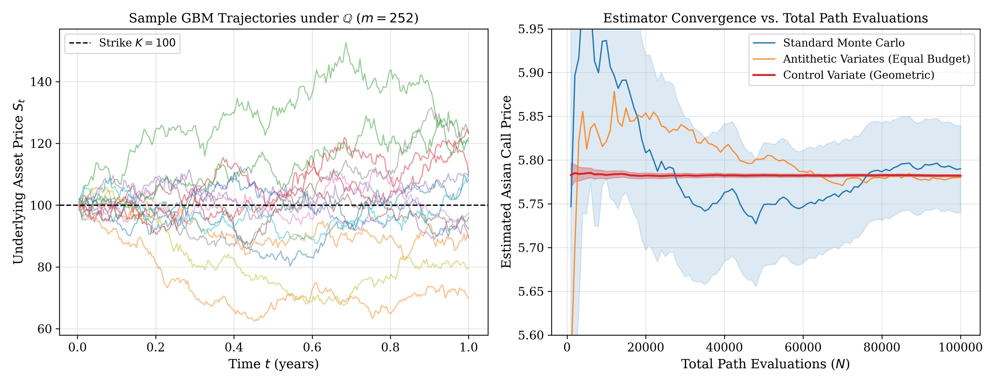

# asian-option-mc-pricing
Independent quantitative project on Asian option pricing using Monte Carlo simulation, variance reduction techniques (control variates), and comprehensive mathematical documentation written in


# Exotic Option Pricing: Monte Carlo Simulation & Control Variate Variance Reduction

This repository implements a vectorized Python pricing engine for **discrete arithmetic Asian options** under the Black-Scholes-Merton framework, accompanied by a formal mathematical research note written in $\LaTeX$.


## 🎯 Overview

Unlike standard European vanilla options, the payoff of an Asian option is **path-dependent** and determined by the average price of the underlying asset over a discrete monitoring grid $(t_1, \dots, t_m)$:

$$H_A = \max\left( \frac{1}{m} \sum_{j=1}^m S_{t_j} - K, \, 0 \right)$$

Because the arithmetic average of log-normal random variables lacks a closed-form analytical distribution, numerical evaluation via **Monte Carlo simulation** is required. To overcome the slow $\mathcal{O}(N^{-1/2})$ convergence rate of naive Monte Carlo, we implement two variance reduction techniques:
1. **Antithetic Variates** (exploiting Gaussian symmetry and the FKG inequality).
2. **Control Variates** leveraging the exact closed-form analytical solution of the **Geometric Asian Call**, whose payoff exhibits a $>99.9\%$ correlation with the arithmetic payoff.

---

## 📊 Numerical Results ($N = 100,000$ paths)

**Market Parameters:** $S_0 = 100$, $K = 100$, $r = 5\%$, $\sigma = 20\%$, $T = 1.0\text{ yr}$, $m = 252\text{ steps}$.

| Estimation Method | Estimated Price | Standard Error | 95% Confidence Interval | Variance Reduction Factor |
| :--- | :---: | :---: | :---: | :---: |
| Standard Monte Carlo | `5.7634` | `0.0252` | `[5.7140, 5.8128]` | **1.0x** |
| Antithetic Variates | `5.7621` | `0.0124` | `[5.7378, 5.7864]` | **4.1x** |
| **Control Variate (Geometric)** | **`5.7628`** | **`0.0010`** | **`[5.7608, 5.7648]`** | **635.0x** |

### Convergence Visualization


> **Key Takeaway:** The geometric control variate reduces estimator variance by a factor of **635x**, achieving with $10^5$ trajectories the same statistical precision that would require over $6.35 \times 10^7$ trajectories using standard Monte Carlo.

---

## 🚀 Usage

1. Install dependencies:
```bash
pip install -r requirements.txt
